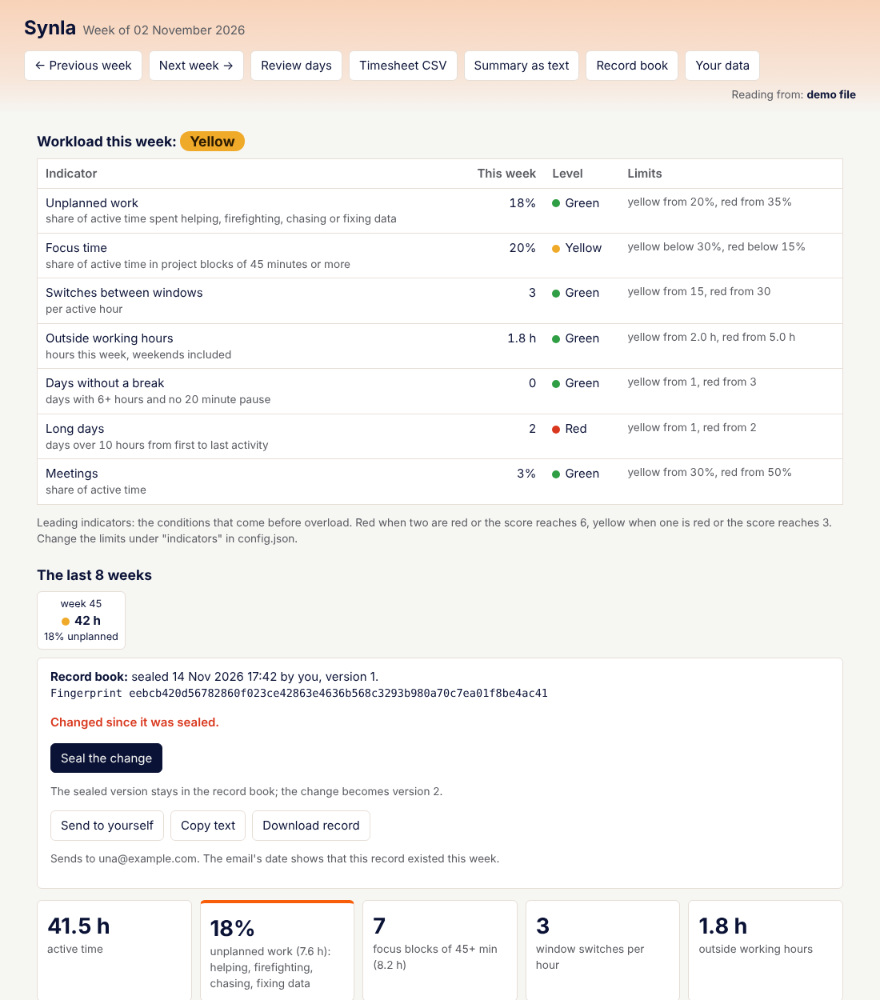
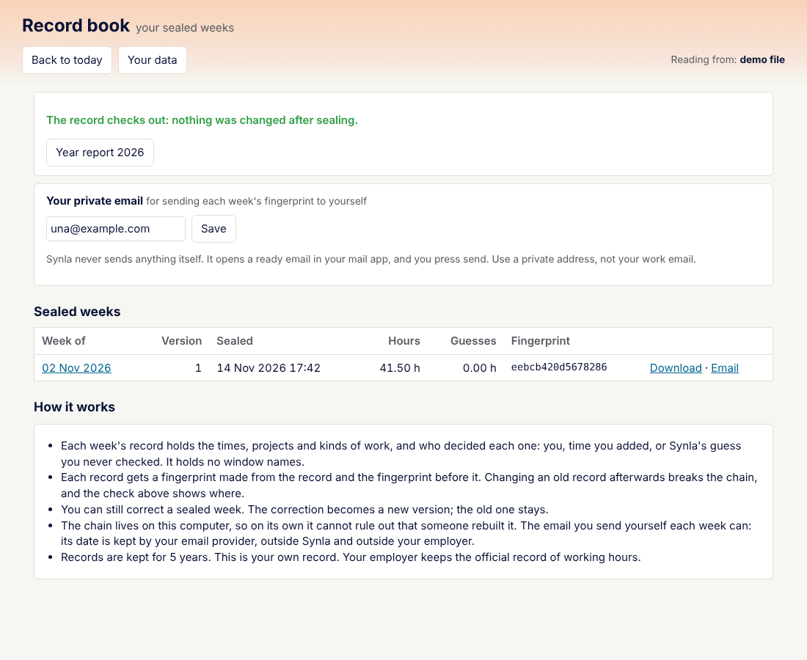

# Synla

[](https://github.com/unamarie/synla/actions/workflows/tests.yml)

Synla fills in your timesheet from what you actually did on your computer. It also shows the work that never makes it
into a plan: helping colleagues, firefighting, chasing information and fixing other people's data.

It is built for the employee. Your data stays on your computer, under your control, and Synla has nothing an
employer could use to monitor anyone.

*Synla* comes from the Nynorsk *synleg*, "visible".


## What it does

- **Works out what each block of time was for.** It looks at file names, folders, email threads and chat names, not
  just which app was open. Then it asks you only about the blocks it isn't sure of.
- **Answer once for the whole day.** "Biggest unsorted windows" lists the windows behind most of the unsorted time.
  One answer covers every stretch of that window today. A block that mixed two things can be split.
- **Learns from your answers.** In the demo week, Monday asks about 10 of 19 blocks. By Friday it asks about 1 of 26,
  and none of the blocks it was sure about were wrong. A window you only glanced at is not learned from.
- **Keeps meetings.** In a call you don't touch the keyboard, so other trackers count you as away. Synla knows when
  you are in a call and keeps that time.
- **Makes unplanned work visible.** The weekly summary shows how much time went to helping, firefighting, chasing and
  fixing data, where it came from, and how much happened outside working hours.
- **Produces the timesheet.** Hours per project and day, rounded to 15 minutes, exported as CSV.
- **Counts time away from the computer.** Add a site visit, a meeting in person or a phone call: from, to, project and
  kind of work. No notes are stored.
- **Watches your workload before it gets too much.** Seven leading indicators (unplanned work, focus time, switches,
  hours outside the working day, days without a break, long days, meetings), each green, yellow or red, and a level
  for the week with the trend over the last eight weeks.
- **Keeps a record book.** Each week is sealed with a fingerprint and kept for years, so you can show what you did
  long after the details are gone. See below.



## Workload indicators

The same idea as a risk model in safety work: instead of counting the bad weeks afterwards, watch the conditions that
come before them. Each indicator is green, yellow or red. The week is red when two indicators are red or the score
reaches 6 (green 0, yellow 1, red 2 points), and yellow when one is red or the score reaches 3.

The limits are starting points. After a few weeks of your own data, set your own under `"indicators"` in
`config.json`, for example `"switches": [20, 40]` for yellow from 20 and red from 40.

## Record book

For when you need to show what you did, long after it happened: overtime that never got registered, a workload
conversation, a dispute.



- **What a record holds.** For each day of the week: the stretches of time with start, end, project, kind of work and
  who decided it (you, time you added, or Synla's guess you never checked), plus totals and the workload numbers.
  No window names, so nothing about colleagues or customers is kept for years.
- **Sealed.** Each record gets a fingerprint (SHA-256) made from the record and the fingerprint before it. The records
  form a chain, so changing an old record afterwards breaks it, and `python -m synla verify` shows where.
- **Corrections stay visible.** You can still correct a sealed week. Sealing it again adds version 2; version 1 stays.
- **Nothing is lost.** Weeks you don't seal yourself are sealed automatically a week after they end, as they stand.
- **An outside timestamp.** The chain lives on your computer, so on its own it cannot rule out that someone rebuilt it.
  So each week Synla prepares an email with the week's fingerprint for you to send to your private address. The
  email's date is kept by your email provider, outside Synla and outside your employer. A rebuilt chain cannot match
  fingerprints you emailed months ago.
- **Year report.** Hours per week, hours above your normal week (37.5 by default), hours outside the working day,
  unplanned work and workload level, with the fingerprint for each week. Print it, save it as PDF or export CSV.
- **Kept for 5 years** by default (`keepRecordYears`).

This is your own record, not the official one. Your employer keeps the official record of working hours. A record made
at the time, never changed afterwards and timestamped outside your own computer carries more weight than memory, but
how much it counts in a dispute is for your union representative or a lawyer to judge. This is not legal advice.

## Built for the employee

**Yours only.** Synla has no account, no server, no admin mode and no way to collect or compare data from several
people. Nothing leaves your computer unless you copy it out yourself, for example the weekly summary.

**What it records.** The app and title of the window in front, and when. Whether you are at the computer. Whether an
app is using the microphone, so calls are not counted as away.

**What it never records.** Keystrokes, screenshots, the clipboard, file contents, sound or web addresses.

**Private windows.** Password managers, private browsing, online banking and health sites are stored as "Private",
with no name. You choose the list in `config.json`. You can pause recording at any time.

**Protected and short-lived.**
- Data lives in `%LOCALAPPDATA%\Synla`, which stays on your computer: it is not part of a roaming profile and is not
  synced to OneDrive.
- On Windows, window names are encrypted with your Windows login, so other accounts, a copied disk or a backup see
  scrambled bytes.
- What Synla learns is stored as one-way codes, never as readable file names or email subjects.
- Window names are deleted after 30 days. After that only the project, the kind of work and the time remain, so your
  timesheet stays while the details about colleagues and customers are gone. Answers and the log go after 90 days.
  The record book keeps sealed weeks, with no window names, for 5 years.
- The **Your data** page shows everything that is stored, and deletes all of it with one click.

**The review page is closed to other websites.** It only answers on 127.0.0.1 and only accepts changes that carry a
secret from Synla's own page, so a web page you have open cannot read or change your data.

**Limits, said plainly.**
- On a computer your employer owns and manages, IT can in principle reach any file, and a domain administrator can
  recover Windows encryption keys. Use Synla on your own computer, or get your employer's written approval first.
- Rules for monitoring at work (in Norway, chapter 9 of the Working Environment Act) are about measures an employer
  starts. Synla is something you start and control, but using it on a work computer still falls under your
  employer's IT rules. This is not legal advice.
- If you use ActivityWatch, it keeps its own history. Synla cannot delete it; you can, in ActivityWatch.

## Three ways to record

| Way | For | Notes |
|---|---|---|
| **Synla's own recorder** | Windows (default) | Nothing else to install. Synla controls what is stored and for how long. |
| **ActivityWatch** | Windows, Mac, Linux | Used automatically if it is running. Its browser extension adds web addresses. |
| **Demo week** | Trying it out | A made-up week, kept in its own folder. |

With `"source": "auto"` (the default), Synla uses its own recorder when it has data for the day, and ActivityWatch
otherwise.

## Try it with a made-up week

You need Python 3.10 or newer. Nothing else is required. On Windows, type `py` where it says `python`.

```
cd synla
python -m synla demo
```

## Use it for real (Windows)

1. Start the recorder: `python -m synla autostart on`. From now on it starts when you sign in to Windows, with no
   window. To start it right away without signing out, run `python -m synla record` once.
2. Open `%LOCALAPPDATA%\Synla\config.json` and add your projects with a few keywords each:

   ```json
   "projects": {
     "Data platform": {"keywords": ["lakehouse", "pipeline"]},
     "Internal": {"keywords": ["timesheet"]}
   }
   ```

3. At the end of the day, run `python -m synla`. Answer the biggest unsorted windows first, then the orange blocks,
   then click **Approve the sure ones**. Add any time away from the computer at the bottom of the day.
4. On Friday, open **Week summary**: check the workload, use **Timesheet CSV**, then **Seal this week** and
   **Send to yourself**. Add your private email once, on the **Record book** page.

| Command | What it does |
|---|---|
| `python -m synla` | Opens the review page for today |
| `python -m synla record` | Runs the recorder in this window (Windows) |
| `python -m synla autostart on` | Starts the recorder at sign-in; `off` stops that |
| `python -m synla pause 60` | Pauses recording for 60 minutes; `resume` starts it again |
| `python -m synla week` | Prints this week's summary as text |
| `python -m synla export --date 2026-11-02` | Writes that week's timesheet as CSV |
| `python -m synla seal` | Seals last week in the record book; `--date` for another week |
| `python -m synla verify` | Checks the whole record book; add a fingerprint or a downloaded record to check that one |
| `python -m synla demo` | Tries Synla with a made-up week |

## How it decides

1. **Segments.** Window activity with away time cut out. Calls keep their time, up to two hours without input.
2. **Clues.** Each window title is split into clues: the exact window, file name, folder, email subject, words, and
   signals such as "reads like a question", "sounds urgent" or "in a call".
3. **Guess.** Each clue votes for a project and a kind of work, from your keywords, a few built-in rules and your
   earlier answers. A clue that always meant the same thing counts fully; a clue seen everywhere, such as "Excel",
   counts for little. Below 70 % confidence, Synla asks you.
4. **Blocks.** Stretches in a row with the same guess form one block. Short, unclear glances join the block before.
5. **Quality.** Synla measures how often it was right only on blocks you checked yourself. Bulk approvals don't count
   as right; if you change one later, it counts as a miss.

Run the tests with `python -m pytest`. They run on Linux and Windows on every push.

## Next

- Planned vs actual: compare against a calendar export.
- Rules you can see and edit: "files in this folder belong to this project".
- Warnings during the week, when an indicator turns red, not only in the week summary.

Built by [Una Marie S. Goksøyr](https://unadata.dev). Code under the MIT licence.
