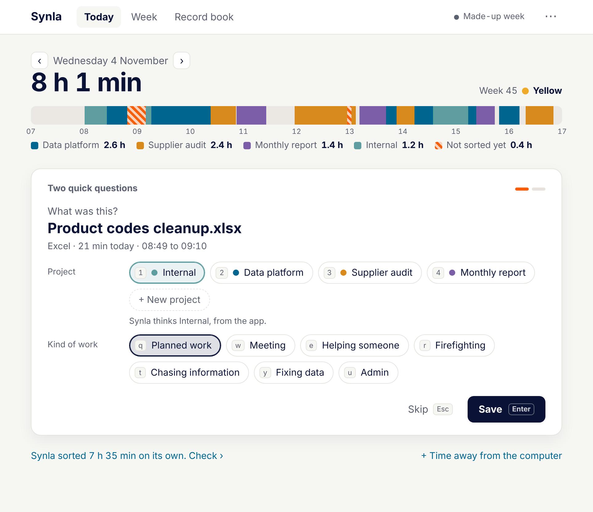
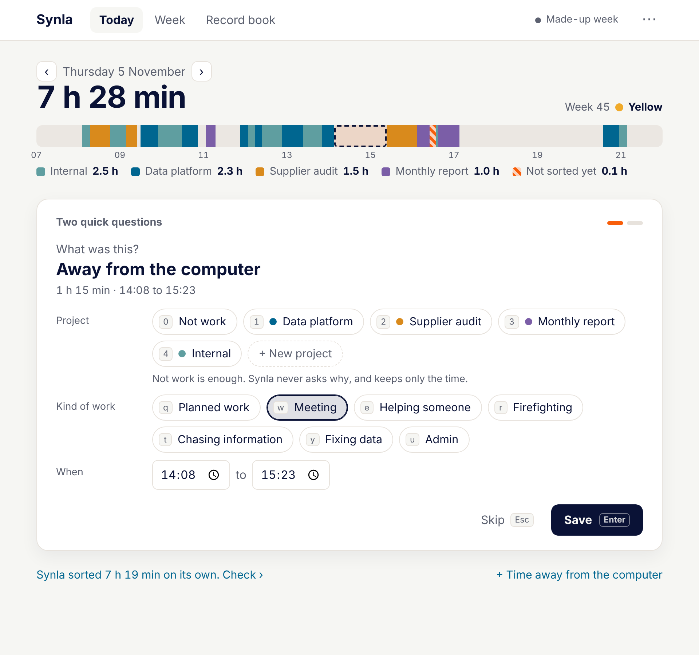
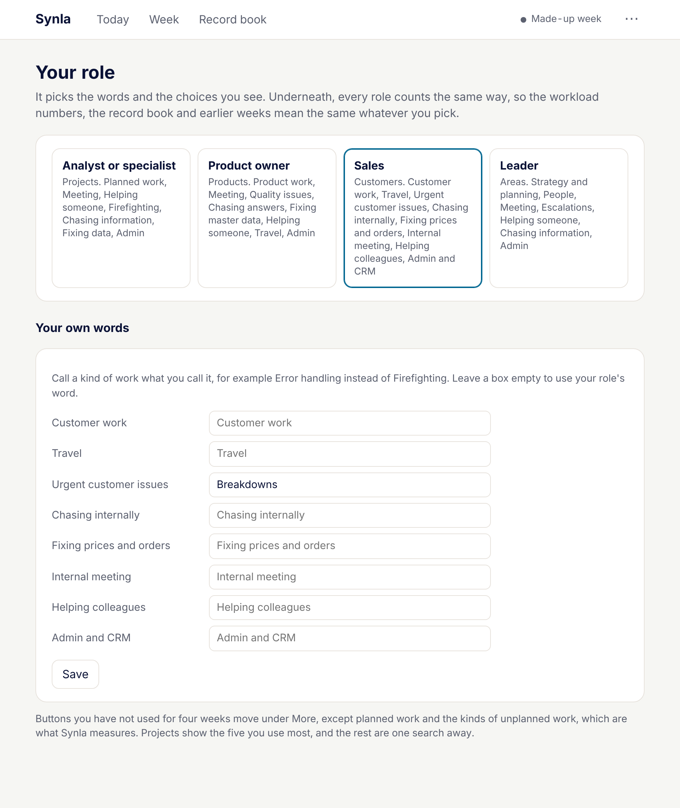

# Synla

[](https://github.com/unamarie/synla/actions/workflows/tests.yml)

Synla fills in your timesheet from what you actually did on your computer. It also shows the work that never makes it
into a plan: helping colleagues, firefighting, chasing information and fixing other people's data.

It is built for the employee. Your data stays on your computer, under your control, and Synla has nothing an
employer could use to monitor anyone.

*Synla* comes from the Nynorsk *synleg*, "visible".



## What it does

- **Synla asks, you tap.** It works out what your time was for from file names, folders, email threads, chat names
  and item, order or change numbers, not just which app was open. It sorts what it is sure of on its own and asks about the rest, one window at a time,
  with its best guess already picked. Press a number for the project, a letter for the kind of work, Enter to save.
- **A few questions, fewer every day.** Only windows of 5 minutes or more, at most five a day. Smaller things keep
  Synla's best guess. In the demo week it asks 5 questions on Monday, then 1, 2, 2 and 1 on Friday: eleven answers
  for 41.1 hours, with 99.7 % of the time on the right project and kind. One answer is enough for the same window.
- **Asks about time away from the computer.** A meeting in a room, a customer visit, a call on your mobile: when you
  were away for 30 minutes or more, starting and ending inside your workday, Synla asks what it was. "Not work" is
  enough, and Synla never asks why. It never asks about mornings, evenings, weekends, lunch or paused time, and after
  two "Not work" answers at the same time of day it stops asking about that break.
- **A reminder at the end of the day.** On Windows, a notification 45 minutes before your workday ends, only when
  there is something to ask and never in the middle of a call. Click it to answer.
- **Shows what keeps coming back.** When the same failure or cleanup returns, the week says so: "Came back on
  4 days since 12 Aug, 6.5 h in all". Window names are deleted after 30 days, so Synla keeps counting for 90 days with
  one-way codes, the same way it stores what it learns.
- **Fits your role.** Pick Analyst or specialist, Product owner, Sales or Leader. The buttons, their order and their
  names follow the role, and you can rename any of them. Projects show the five you use most, with a search for the
  rest. After four weeks, kinds of work you never use move under More. The order stays put, so the keys do too.
- **Undo instead of "are you sure?".** Every answer can be taken back for a few seconds, including what Synla learned
  from it.
- **Keeps meetings.** In a call you don't touch the keyboard, so other trackers count you as away. Synla knows when
  you are in a call and keeps that time.
- **Makes unplanned work visible.** The weekly summary shows how much time went to helping, firefighting, chasing and
  fixing data, where it came from, and how much happened outside working hours.
- **Produces the timesheet.** Hours per project and day, rounded to 15 minutes, exported as CSV.
- **Counts time away from the computer.** Add a site visit, a meeting in person or a phone call: from, to, project and
  kind of work. No notes are stored.
- **Watches your workload before it gets too much.** Seven leading indicators (unplanned work, focus time, switches,
  hours outside the working day, days without a break, long days, meetings), each green, yellow or red. The week page
  sums them up in one line, such as "Yellow week. Two long days and little time for focused work."
- **Keeps a record book.** Each week is sealed with a fingerprint and kept for years, so you can show what you did
  long after the details are gone. See below.




## Workload indicators

The same idea as a risk model in safety work: instead of counting the bad weeks afterwards, watch the conditions that
come before them. Each indicator is green, yellow or red. The week is red when two indicators are red or the score
reaches 6 (green 0, yellow 1, red 2 points), and yellow when one is red or the score reaches 3.

The limits are starting points. After a few weeks of your own data, set your own under `"indicators"` in
`config.json`, for example `"switches": [20, 40]` for yellow from 20 and red from 40.

## Record book

For when you need to show what you did, long after it happened: overtime that never got registered, a workload
conversation, a dispute.


- **What a record holds.** For each day of the week: the stretches of time with start, end, project, kind of work and
  who decided it (you, time you added, or Synla on its own), plus totals and the workload numbers.
  No window names, so nothing about colleagues or customers is kept for years.
- **Sealed.** Each record gets a fingerprint (SHA-256) made from the record and the fingerprint before it. The records
  form a chain, so changing an old record afterwards breaks it, and `python -m synla verify` shows where.
- **Corrections stay visible.** You can still correct a sealed week. Sealing it again adds version 2; version 1 stays.
- **Nothing is lost.** Weeks you don't seal yourself are sealed automatically a week after they end, as they stand.
- **An outside timestamp.** The chain lives on your computer, so on its own it cannot rule out that someone rebuilt it.
  So each week Synla prepares an email with the week's fingerprint for you to send to your private address. The
  email's date is kept by your email provider, outside Synla and outside your employer. A rebuilt chain cannot match
  fingerprints you emailed months ago.
- **Year report.** Hours per week, hours above your normal week (37.5 by default), hours outside the working day,
  unplanned work and workload level, with the fingerprint for each week. Print it, save it as PDF or export CSV.
- **Kept for 5 years** by default (`keepRecordYears`).

This is your own record, not the official one. Your employer keeps the official record of working hours. A record made
at the time, never changed afterwards and timestamped outside your own computer carries more weight than memory, but
how much it counts in a dispute is for your union representative or a lawyer to judge. This is not legal advice.

## Roles

Underneath, every role counts the same kinds of work, so the workload numbers, the record book and earlier weeks
mean the same whatever you pick. The role decides what you see and what it is called.

| | Analyst or specialist | Product owner | Sales | Leader |
|---|---|---|---|---|
| Projects are called | Projects | Products | Customers | Areas |
| Planned work | Planned work | Product work | Customer work | Strategy and planning |
| Unplanned | Helping someone, Firefighting, Chasing information, Fixing data | Helping someone, Quality issues, Chasing answers, Fixing master data | Helping colleagues, Urgent customer issues, Chasing internally, Fixing prices and orders | Helping someone, Escalations, Chasing information |
| Also | Meeting, Admin | Meeting, Travel, Admin | Internal meeting, Travel, Admin and CRM | People, Meeting, Admin |



## Built for the employee

**Yours only.** Synla has no account, no server, no admin mode and no way to collect or compare data from several
people. Nothing leaves your computer unless you copy it out yourself, for example the weekly summary.

**What it records.** The app and title of the window in front, and when. Whether you are at the computer. Whether an
app is using the microphone, so calls are not counted as away.

**What it never records.** Keystrokes, screenshots, the clipboard, file contents, sound or web addresses.

**Private windows.** Password managers, private browsing, online banking and health sites are stored as "Private",
with no name. You choose the list in `config.json`.

**Paused means paused.** You can pause recording at any time. Synla keeps only when each pause started and ended, never
asks about that time, and hides anything ActivityWatch recorded during it.

**Time away stays yours.** Questions about time away only cover your workday, and "Not work" keeps nothing but the
time. Turn the questions off on the **Your data** page.

**Protected and short-lived.**
- Data lives in `%LOCALAPPDATA%\Synla`, which stays on your computer: it is not part of a roaming profile and is not
  synced to OneDrive.
- On Windows, window names are encrypted with your Windows login, so other accounts, a copied disk or a backup see
  scrambled bytes.
- What Synla learns, and what keeps coming back, is stored as one-way codes, never as readable file names or email
  subjects.
- Window names are deleted after 30 days. After that only the project, the kind of work and the time remain, so your
  timesheet stays while the details about colleagues and customers are gone. Answers and the log go after 90 days.
  The record book keeps sealed weeks, with no window names, for 5 years.
- The **Your data** page shows everything that is stored, and deletes all of it with one click.

**Synla's pages are closed to other websites.** They only answer on 127.0.0.1 and only accept changes that carry a
secret from Synla's own pages, so a web page you have open cannot read or change your data.

**What it changes on Windows.** Three entries under your own user in the registry, no admin rights: start the
recorder at sign-in, the link `synla:open` that the reminder opens, and the name on the notification.
`python -m synla autostart off` removes all three.

**Limits, said plainly.**
- On a computer your employer owns and manages, IT can in principle reach any file, and a domain administrator can
  recover Windows encryption keys. Use Synla on your own computer, or get your employer's written approval first.
- Rules for monitoring at work (in Norway, chapter 9 of the Working Environment Act) are about measures an employer
  starts. Synla is something you start and control, but using it on a work computer still falls under your
  employer's IT rules. This is not legal advice.
- If you use ActivityWatch, it keeps its own history. Synla cannot delete it; you can, in ActivityWatch.

## Three ways to record

| Way | For | Notes |
|---|---|---|
| **Synla's own recorder** | Windows (default) | Nothing else to install. Synla controls what is stored and for how long. |
| **ActivityWatch** | Windows, Mac, Linux | Used automatically if it is running. Its browser extension adds web addresses. |
| **Demo week** | Trying it out | A made-up week, kept in its own folder. |

With `"source": "auto"` (the default), Synla uses its own recorder when it has data for the day, and ActivityWatch
otherwise.

## Try it with a made-up week

You need Python 3.10 or newer. Nothing else is required. On Windows, type `py` where it says `python`.

```
cd synla
python -m synla demo
```

## Use it for real (Windows)

1. Start the recorder: `python -m synla autostart on`. From now on it starts when you sign in to Windows, with no
   window. To start it right away without signing out, run `python -m synla record` once.
2. Open `%LOCALAPPDATA%\Synla\config.json` and add your projects with a few keywords each:

   ```json
   "projects": {
     "Data platform": {"keywords": ["lakehouse", "pipeline"]},
     "Gearbox G2": {"keywords": ["gearbox", "4500-"]},
     "Internal": {"keywords": ["timesheet"]}
   }
   ```

   Keywords can be numbers: `"4500-"` matches every item number that starts with 4500, in ERP and PLM screens too.
   The first time you open Synla, pick the role that fits your work. You can change it under **⋯ > Your role and
   words**.

3. At the end of the day, click the reminder (or run `python -m synla`) and answer Synla's questions, including
   the ones about time away from the computer. To see what Synla sorted on its own, click **Check**.
4. On Friday, open **Week**: read the level for the week, then **Seal this week** and **Send to yourself**. The
   timesheet is one click away. Add your private email once, on the **Record book** page.

| Command | What it does |
|---|---|
| `python -m synla` | Opens Synla's pages for today |
| `python -m synla record` | Runs the recorder in this window (Windows) |
| `python -m synla autostart on` | Starts the recorder at sign-in, with the reminder; `off` stops both |
| `python -m synla remind` | Shows what the end of day reminder looks like |
| `python -m synla pause 60` | Pauses recording for 60 minutes; `resume` starts it again |
| `python -m synla week` | Prints this week's summary as text |
| `python -m synla export --date 2026-11-02` | Writes that week's timesheet as CSV |
| `python -m synla seal` | Seals last week in the record book; `--date` for another week |
| `python -m synla verify` | Checks the whole record book; add a fingerprint or a downloaded record to check that one |
| `python -m synla demo` | Tries Synla with a made-up week |

## How it decides

1. **Segments.** Window activity with away time cut out. Calls keep their time, up to two hours without input.
2. **Clues.** Each window title is split into clues: the exact window, file name, folder, email subject, numbers such
   as 4500-1203 or ECR-2026-0153, words, and signals such as "reads like a question", "sounds urgent" or "in a call".
   Years, dates, times and versions are not counted as numbers. In Outlook, Synla tells an email from a meeting invite
   and the calendar. Reading an invite is not a meeting, and the word "meeting" only counts in Teams, Zoom or Webex.
3. **Guess.** Each clue votes for a project and a kind of work, from your keywords, a few built-in rules and your
   earlier answers. A clue that always meant the same thing counts fully; a clue seen everywhere, such as "Excel",
   counts for little. The very same window is trusted after one answer.
4. **Kind of work.** Learned only from the window itself and its shape (a call, a chat, an email thread), never from
   topic words, so one answer that a standup was a meeting doesn't make every window about the same project a meeting.
5. **Questions.** Below 70 % confidence for a window of 5 minutes or more, Synla asks, biggest first, at most five a
   day, together with time away from the computer. Stretches in a row with the same guess form one block; short,
   unclear glances join the block before.

Run the tests with `python -m pytest`. They run on Linux and Windows on every push.

## Next

- Meetings recorded on their own: Synla notes that it was a meeting, and you only say what it was for. Most of a
  leader's week is meetings, so "Meeting" as a kind of work says little.
- Workload limits for each role: a leader switches between windows far more than an analyst.
- Calendar: Outlook meetings could fill in time away on their own, once other people's meeting titles can be kept
  private.
- Rules you can see and edit: "files in this folder belong to this project".
- Warnings during the week, when an indicator turns red, not only in the week summary.

Built by [Una Marie S. Goksøyr](https://unadata.dev). Code under the MIT licence.
